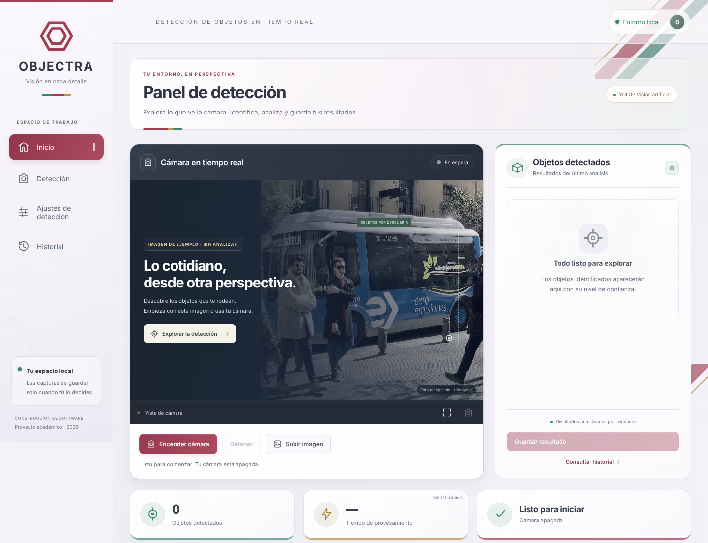
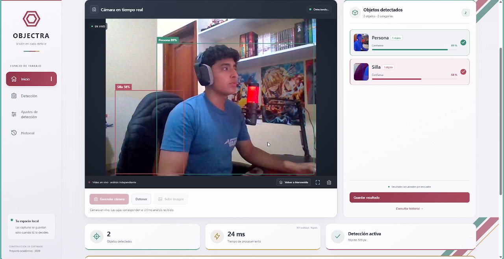
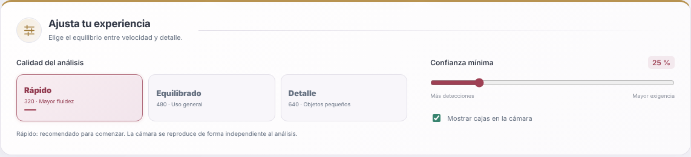
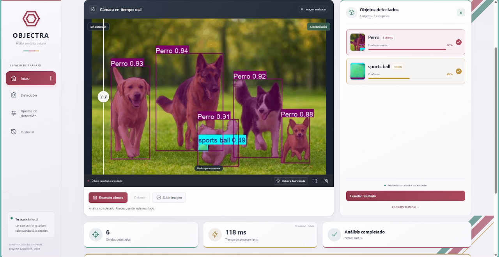
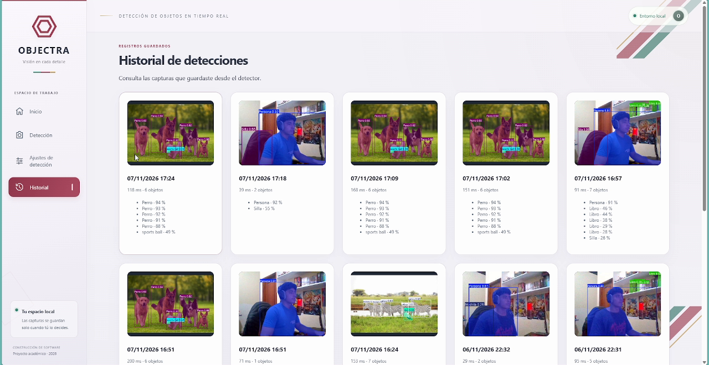

UNIVERSIDAD ESTATAL DE MILAGRO

Facultad de Ciencias e Ingenierías
Carrera de Ingeniería de Software

OBJECTRA

Documentación técnica
y manual de usuario

Guía práctica n.º 4 · Construcción de Software
Entregable 3 · Unidad 4

Integrantes

Jhoan Ariel Cevallos Villavicencio

Jean Pierre Jimenez Bajaña

Cesar Paul Lopez Santillan

Isaac Anthony Silva Quiroz

Daniela Naomi Villamar Lucas

**Docente de la práctica:** Mariana Madeleine Almache Sanisaca
**Docente de la asignatura:** Rodrigo Josue Guevara Reyes

Milagro, Ecuador · Documento elaborado el 19 de noviembre de 2026

Versión documental 1.0 · La fecha de elaboración no sustituye la fecha de entrega del aula.

UNIDAD 4  /  01

Propósito, alcance y organización


## Propósito, alcance y organización


OBJECTRA es una aplicación web académica que identifica y segmenta objetos en imágenes o fotogramas de una cámara. Presenta las detecciones en el navegador y permite guardar resultados propios para consultarlos posteriormente.

Este documento desarrolla el **entregable 3** de la guía: documentación técnica y de usuario con capturas. Describe el código de la rama principal revisado el 19 de noviembre de 2026 y las correcciones propuestas del instalador. El código base consultado corresponde al commit **aadfac19fccbc3194f58ba77a3add3d7f61dd29b**.

| Entregable de Unidad 4 | Estado de esta preparación |
| --- | --- |
| 1. Código fuente con pruebas | Pendiente de revisión y cierre para esta práctica. |
| 2. Reporte de pruebas | Pendiente de ejecución y recopilación de evidencias actuales. |
| 3. Documentación técnica y de usuario | Desarrollada en este documento. Ajuste a la plantilla específica del aula pendiente. |


Cómo leer el documento

| Apartado | Página |
| --- | --- |
| Requisitos y componentes | 3 |
| Instalación desde el repositorio | 4 |
| Instalación asistida y demo | 5 |
| Estructura, datos y API | 6 |
| Inicio y ejemplo de detección | 7 |
| Cámara y controles | 8 |
| Análisis de una imagen propia | 9 |
| Guardado e historial | 10 |
| Interpretación y solución de problemas | 11 |
| Mantenimiento, pendientes y fuentes | 12 |


Origen de las capturas

Las figuras se recuperaron de la demostración ya publicada por el equipo y del PR #4 de la interfaz. Son ilustraciones del uso de OBJECTRA; no constituyen una ejecución nueva de las pruebas de Unidad 4. Se recortó únicamente el marco del navegador cuando fue necesario. Los tiempos y conteos visibles pertenecen al ejemplo grabado.

UNIDAD 4  /  02

Requisitos y componentes


## Requisitos y componentes


| Componente | Configuración documentada |
| --- | --- |
| Sistema y equipo | Windows x64 para el instalador; cámara disponible para la detección en vivo. |
| Navegador | Navegador con acceso a cámara autorizado en http://127.0.0.1:8000/. |
| Python | Python 3.13 para la instalación de desarrollo documentada. |
| Base de datos | PostgreSQL 14 o posterior según README; instancia privada del instalador en 127.0.0.1:55432. |
| Conexión inicial | Internet para obtener código y dependencias. WinGet si el instalador debe preparar componentes del sistema. |
| Modelos | Tres exportaciones OpenVINO suministradas por el equipo; no están incluidas en el ZIP de código fuente. |


Dependencias fijadas por el proyecto

| Paquete | Versión en requirements.txt | Función |
| --- | --- | --- |
| Django | 5.2.17 | Servidor, rutas, plantillas y persistencia. |
| psycopg[binary] | 3.3.8 | Conexión de Python con PostgreSQL. |
| ultralytics | 8.4.146 | Carga y ejecución del modelo YOLO. |
| opencv-python | 5.0.0.93 | Decodificación y preparación de imágenes. |
| openvino | 2026.3.1 | Ejecución de las exportaciones del modelo. |
| numpy | 2.4.6 | Tratamiento de arreglos de imagen. |


Estas versiones son las declaradas en el repositorio, no una certificación de instalación en cualquier equipo. El proyecto no fija un mínimo de RAM ni de CPU; el rendimiento debe comprobarse en el computador de uso.

Modelos de análisis

| Modo | Entrada | Carpeta bajo models/ |
| --- | --- | --- |
| Rápido | 320 × 320 | yolo11s-seg-eva-320_openvino_model |
| Equilibrado | 480 × 480 | yolo11s-seg-eva-480_openvino_model |
| Detalle | 640 × 640 | yolo11s-seg_openvino_model |


Cada carpeta necesita metadata.yaml y un par .xml/.bin de la misma exportación. YOLO_MODEL_PATH permite cambiar la ruta del modo Rápido; los otros modos se configuran en QUALITY_MODELS. El modelo utiliza 80 categorías COCO.

UNIDAD 4  /  03

Instalación desde el repositorio


## Instalación desde el repositorio


1. Obtener el código y preparar Python

Instala Python 3.13, Git y PostgreSQL antes de seguir la ruta manual. Abre PowerShell en una carpeta local con permiso de escritura y ejecuta:


```text
git clone https://github.com/Sshadowcitoo/OBJECTRA.git
cd OBJECTRA
py -3.13 -m venv .venv
.\.venv\Scripts\python.exe -m pip install -r requirements.txt
New-Item -ItemType Directory -Force .local
Copy-Item .local.example\database.json .local\database.json
```


Si .local/database.json ya existe, conserva el archivo y revisa su contenido antes de copiar otro encima. No publiques las credenciales en GitHub. Si descargaste Code → Download ZIP, extrae toda la carpeta y abre PowerShell allí.

2. Preparar PostgreSQL

Desde pgAdmin u otra sesión administrativa de PostgreSQL, crea un rol objectra y una base de su propiedad. Sustituye la contraseña de muestra por una propia. La base test_objectra se necesitará cuando se retome el punto 1.


```text
CREATE ROLE objectra WITH LOGIN PASSWORD 'CAMBIA_ESTA_CLAVE';
CREATE DATABASE objectra OWNER objectra;
-- Preparar al retomar las pruebas:
CREATE DATABASE test_objectra OWNER objectra;
```


Edita .local/database.json para que coincida con tu instalación:


```text
{
  "DB_NAME": "objectra",
  "DB_USER": "objectra",
  "DB_PASSWORD": "TU_CLAVE_LOCAL",
  "DB_HOST": "127.0.0.1",
  "DB_PORT": "5432"
}
```


3. Colocar los modelos e iniciar

Copia las tres carpetas indicadas en la página 3 dentro de models/. Mantén PostgreSQL encendido y ejecuta .\start-local.ps1. El script comprueba la conexión, aplica migraciones y abre el servidor local. Visita http://127.0.0.1:8000/ y deja la consola abierta.

Las variables DB_* tienen prioridad sobre el JSON. .env.example es una referencia: la aplicación no carga automáticamente un archivo .env.

UNIDAD 4  /  04

Instalación asistida y demo Windows


## Instalación asistida y demo Windows


Ruta asistida del código corregido

La revisión propuesta incorpora setup-local.ps1 y scripts/ a partir del instalador del equipo. Usa esta ruta desde la carpeta completa del proyecto que contenga esos archivos. Si main aún no incluye la revisión, utiliza su rama de cambios; el ZIP antiguo de la release no se actualiza al modificar el repositorio.


```text
.\setup-local.ps1 -ModelsSource "C:\ruta\models" -NoStart
.\start-local.ps1
```


ModelsSource apunta a la carpeta que contiene las tres exportaciones. Si ya están completas bajo models/, omite ese parámetro. NoStart prepara el entorno sin abrir Django. El iniciador reutiliza la configuración local existente; si hay credenciales configuradas, deben ser válidas.

| Paso del instalador | Resultado previsto |
| --- | --- |
| Entorno | Prepara Python 3.13 y Visual C++ mediante WinGet cuando corresponda; crea .venv. |
| Dependencias y modelos | Instala requirements.txt y comprueba o copia las tres exportaciones. |
| PostgreSQL privado | Prepara una instancia bajo .local/ y usa el puerto 55432. |
| Arranque | start-local.ps1 inicia la instancia privada cuando corresponde, migra y ejecuta Django. |


Corrección de la incidencia de rutas largas

La extracción anterior incluía pgAdmin y fallaba por una ruta larga. El extractor corregido selecciona solo bin, lib y share, comprueba los ejecutables esenciales y excluye pgAdmin. Prepara el contenido en una carpeta temporal antes de instalarlo. No borra bases ni sustituye silenciosamente una instalación parcial.

**Estado:** corrección del código fuente preparada y comprobaciones específicas del extractor realizadas por separado. La instalación integral en una PC Windows limpia y la reconstrucción del ZIP publicado continúan pendientes. No se declara validada la demo corregida.

Demo publicada v0.1.0-demo

Descarga OBJECTRA-Demo-Windows.zip desde Releases, extrae todo el contenido y abre Iniciar OBJECTRA.cmd. El paquete contiene los modelos. El primer arranque requiere Internet y puede requerir WinGet. Usa una carpeta local corta para facilitar la instalación. La release existente conserva la incidencia histórica hasta su actualización.

UNIDAD 4  /  05

Estructura, datos y comunicación


## Estructura, datos y comunicación


| Ruta | Responsabilidad |
| --- | --- |
| config/settings.py | Base de datos, idioma, zona horaria y rutas de modelos. |
| config/urls.py | Entrada principal, historial y endpoints de detección y guardado. |
| detector/vision.py | Decodifica imágenes, ejecuta YOLO, traduce clases y genera imagen anotada. |
| detector/views.py | Valida solicitudes, entrega resultados y guarda capturas. |
| detector/models.py y migrations/ | Modelo Capture y estructura de almacenamiento. |
| templates/detector/ | Plantillas de inicio, base e historial. |
| static/detector/ | Estilos, interacción JavaScript, agrupación y ejemplo. |
| models/ y .local/ | Exportaciones externas y configuración privada local. |
| scripts/ y archivos .ps1 | Preparación y arranque de la revisión del instalador. |
| detector/tests.py y tests/ | Pruebas existentes; revisión para Unidad 4 pendiente. |


Flujo de una detección

El navegador envía una imagen o un fotograma a Django. El servidor valida tamaño, confianza y calidad; OpenCV decodifica el archivo y YOLO ejecuta la segmentación con la exportación seleccionada. La respuesta vuelve con la imagen anotada, detecciones y tiempo de procesamiento. La base de datos se utiliza al guardar el resultado y al consultar el historial.

| Método y ruta | Función / respuesta principal |
| --- | --- |
| GET / | Presenta el panel de detección. |
| GET /historial/ | Muestra capturas guardadas; 12 registros por página. |
| POST /api/detect/ | Recibe frame, confidence, quality y source. Devuelve detections, processing_ms, image, token y can_save. |
| POST /api/save/ | Recibe token firmado; devuelve el id creado con estado 201. |


Capture almacena fecha de creación, detecciones en JSON, tiempo en milisegundos e imagen anotada como texto de datos. El orden es del registro más reciente al más antiguo. El token de guardado vence después de 900 segundos; un ejemplo no recibe token de guardado. Las solicitudes POST requieren protección CSRF.

UNIDAD 4  /  06

Primer uso y ejemplo de detección


## Primer uso y ejemplo de detección


Abre http://127.0.0.1:8000/. Al inicio, la cámara está apagada y el panel de objetos está vacío. La imagen de bienvenida es una muestra sin analizar. Los accesos laterales permiten volver al inicio, ubicar la detección, abrir los ajustes y consultar el historial.

Figura 1. Panel inicial de OBJECTRA. Captura original de la interfaz publicada en el PR #4.




Explorar sin encender la cámara

**1.** Pulsa **Explorar la detección** en la imagen de bienvenida.
**2.** Espera el análisis; el comparador mostrará la imagen original y la anotada.
**3.** Arrastra el divisor central para comparar. También puedes enfocar el control y usar las flechas del teclado.
**4.** Consulta el listado de categorías y sus cantidades.
**5.** Pulsa **Volver a bienvenida** para regresar al estado inicial.

La imagen de ejemplo es solo demostrativa: Guardar resultado y Guardar captura permanecen desactivados. Subir el mismo archivo con otro nombre tampoco permite guardarlo, porque el servidor reconoce su contenido. Para crear un registro usa la cámara o una imagen propia.

En la primera inferencia de cada calidad se carga el modelo. Una espera inicial mayor no significa necesariamente que el sistema esté detenido.

UNIDAD 4  /  07

Cámara en vivo y controles


## Cámara en vivo y controles


**1.** Pulsa **Encender cámara** y acepta el permiso del navegador.
**2.** Apunta hacia objetos con iluminación suficiente y espera los resultados.
**3.** Cambia la calidad o la confianza si lo necesitas.
**4.** Usa **Mostrar cajas en la cámara** para alternar los recuadros. El botón de ampliar abre la vista en pantalla completa.
**5.** Pulsa **Detener** cuando termines. Guarda el resultado deseado antes de cerrar el trabajo.

Figura 2. Detección con cámara durante la demostración del equipo, fotograma 01:10. Las cifras visibles pertenecen a esa grabación.




Figura 3. Selector de calidad, confianza mínima y control de cajas. Recorte de la captura del PR #4.




| Control | Uso práctico |
| --- | --- |
| Rápido / Equilibrado / Detalle | Comienza con Rápido. Cambia de modo para observar el equilibrio entre fluidez y detalle en tu equipo. |
| Confianza mínima, 10 % a 90 % | Un umbral más alto exige una puntuación mayor para mostrar objetos; uno menor permite más detecciones. El valor inicial es 25 %. |
| Detener | Interrumpe la captura en vivo. El video y el análisis funcionan de manera independiente. |


Si rechazas el permiso, habilítalo desde la configuración del sitio en el navegador y vuelve a intentarlo. Cierra otras aplicaciones si la cámara está ocupada.

UNIDAD 4  /  08

Analizar una imagen propia


## Analizar una imagen propia


**1.** Pulsa **Subir imagen** y elige una fotografía JPEG, PNG o WebP.
**2.** Usa un archivo de hasta 2 MB. El servidor también rechaza imágenes cuyo producto ancho × alto exceda 1920 × 1080 píxeles.
**3.** Espera el análisis y observa el comparador.
**4.** Mueve el divisor para revisar las diferencias entre el original y el resultado.
**5.** Lee las categorías, cantidades y confianza. Si deseas conservar ese resultado, pulsa **Guardar resultado**.

Figura 4. Imagen propia analizada en la demostración del equipo, fotograma 01:30. El comparador muestra la segmentación y el panel agrupa las detecciones.




Qué revisar al comparar

Comprueba que las cajas y áreas coloreadas se correspondan con los objetos visibles. Una categoría puede contener varios objetos; despliega el grupo para consultar sus elementos. Revisa errores de clasificación y objetos que el detector no haya reconocido.

Si la imagen no se admite

Reduce su peso o resolución y vuelve a subirla. Un archivo renombrado como .jpg no garantiza que sea una imagen válida. La aplicación verifica que OpenCV pueda decodificarlo. Si el análisis indica que falta un modelo, revisa la exportación de la calidad seleccionada.

Modificar la confianza o la calidad no modifica las categorías aprendidas por el modelo. OBJECTRA reconoce las clases con las que fue preparado; no aprende una categoría nueva por cambiar una etiqueta.

UNIDAD 4  /  09

Guardar y consultar el historial


## Guardar y consultar el historial


**1.** Analiza una imagen propia o utiliza la cámara.
**2.** Pulsa **Guardar resultado** o el icono **Guardar captura**.
**3.** Espera la confirmación y evita repetir el clic mientras se procesa.
**4.** Abre **Consultar historial** o el acceso **Historial** del menú.
**5.** Revisa la fecha, imagen anotada, tiempo y objetos del registro.

Figura 5. Historial mostrado en la demostración existente, fotograma 01:50. Los registros ilustran capturas de cámara e imágenes guardadas.




Organización de los registros

Las tarjetas aparecen de la más reciente a la más antigua. Cada página contiene hasta 12 capturas. Cuando hay más registros, utiliza Anterior y Siguiente. Si todavía no guardaste capturas, el sistema muestra un estado vacío y un enlace para abrir el detector.

Conservación de resultados

Los resultados propios solo se almacenan cuando se solicita guardarlos; analizar una imagen no la añade automáticamente al historial. Los registros persisten en la base configurada. No elimines la base ni la carpeta de datos de PostgreSQL si necesitas conservarlos.

Si el resultado expiró, vuelve a analizar la imagen antes de guardarla. El guardado usa un token firmado válido durante 15 minutos. El historial de la instalación es común a esa base: esta versión no dispone de cuentas de usuario ni separación individual de registros.

UNIDAD 4  /  10

Interpretación y solución de problemas


## Interpretación y solución de problemas


| Indicador | Cómo interpretarlo |
| --- | --- |
| Objeto / categoría | Nombre asignado por el modelo. Algunas clases conservan su nombre original en inglés. |
| Cantidad | Objetos del último encuadre analizado. No es un conteo acumulado de personas u objetos distintos a lo largo del video. |
| Confianza | Puntuación del modelo para esa detección. Una confianza de 90 % no garantiza 90 % de exactitud del sistema. |
| Confianza media | Promedio de las puntuaciones de los objetos agrupados en una categoría. |
| Área de segmentación | Porcentaje de la máscara dentro de su encuadre, cuando está disponible en la respuesta. No es una medida física del objeto. |
| Tiempo de procesamiento | Duración del análisis del servidor en ms; puede incluir carga del modelo. La tasa análisis/s del cliente incluye la espera de la solicitud y no equivale a FPS del video. |


Problemas frecuentes

| Situación | Acción recomendada |
| --- | --- |
| No abre localhost | Confirma que la consola del servidor siga abierta, que no haya errores y que uses 127.0.0.1:8000. |
| Falla la conexión PostgreSQL | Comprueba servicio, puerto y credenciales de .local/database.json; revisa variables DB_* que puedan sobrescribirlos. |
| Falta modelo / error 503 | Comprueba la carpeta de la calidad elegida y que incluya metadata.yaml, .xml y .bin. |
| No se detectan objetos | Prueba otra posición, mejora la iluminación y revisa la confianza. Una escena puede devolver cero detecciones sin ser un error. |
| Guardar está desactivado | Verifica que no sea el ejemplo, que haya terminado el análisis y que no exista un guardado en curso. |
| Instalación parcial / ruta larga | Usa la revisión del instalador, conserva los datos existentes y revisa .local/postgresql. El ZIP antiguo aún requiere actualización. |


UNIDAD 4  /  11

Mantenimiento, pendientes y fuentes


## Mantenimiento, pendientes y fuentes


Arranque y cierre habituales

Desde la carpeta raíz, ejecuta .\start-local.ps1 y abre el navegador. Para finalizar, pulsa Ctrl+C en la consola. Si ese script inició la instancia privada de PostgreSQL, intenta detenerla al salir; una instancia que ya estaba activa no se detiene por ese motivo. Conserva la configuración y los datos locales.

Conservación y mantenimiento

Mantén requirements.txt y los tres modelos coherentes con la versión de código. Antes de cambiar de equipo o reinstalar, respalda la base con una herramienta PostgreSQL como pgAdmin o pg_dump. Conserva el respaldo fuera de la carpeta de trabajo y comprueba su restauración antes de eliminar el original. No subas .local/, contraseñas, bases ni entornos virtuales al repositorio.

Pruebas y cierre pendientes de Unidad 4

Existen pruebas en detector/tests.py y tests/detection-groups.test.cjs, además de resultados históricos en docs/VERIFICACION_DEMO.md. Su revisión, ejecución y reporte para esta práctica quedan pendientes. No se incluyen aquí nuevos logs, aprobación funcional ni código de pruebas como entregables terminados.

| Pendiente | Evidencia necesaria para cerrarlo |
| --- | --- |
| Entregable 1 | Código revisado de pruebas unitarias e integración y su inclusión en el informe final. |
| Entregable 2 | Resultados actuales, logs, capturas y análisis de pruebas unitarias, integración y funcionales. |
| Instalador y release | Primer arranque completo en Windows limpio y ZIP reconstruido con la corrección. |
| Cierre documental | Plantilla vigente del aula, fecha límite y revisión del contenido/enlaces por todos los integrantes. |


Fuentes del proyecto

**Repositorio y código fuente.** [https://github.com/Sshadowcitoo/OBJECTRA](https://github.com/Sshadowcitoo/OBJECTRA)

**Modelos y requisitos.** [https://github.com/Sshadowcitoo/OBJECTRA/blob/main/models/README.md](https://github.com/Sshadowcitoo/OBJECTRA/blob/main/models/README.md)

**Documentación y antecedentes de verificación.** [https://github.com/Sshadowcitoo/OBJECTRA/tree/main/docs](https://github.com/Sshadowcitoo/OBJECTRA/tree/main/docs)

**Capturas originales de la interfaz (PR #4).** [https://github.com/Sshadowcitoo/OBJECTRA/pull/4](https://github.com/Sshadowcitoo/OBJECTRA/pull/4)

**Demo distribuida.** [https://github.com/Sshadowcitoo/OBJECTRA/releases/tag/v0.1.0-demo](https://github.com/Sshadowcitoo/OBJECTRA/releases/tag/v0.1.0-demo)

**Video del equipo, duración 2:51.** [https://drive.google.com/file/d/1VlUZ9dLxV1Qq9Yt86QmBOE9MtSD1baBs/view](https://drive.google.com/file/d/1VlUZ9dLxV1Qq9Yt86QmBOE9MtSD1baBs/view)

Guía académica: UNEMI, Guía práctica n.º 4 de Construcción de Software, Unidad 4, documento facilitado por el estudiante, aprobado en noviembre de 2026. No se establece en esta guía una fecha límite de entrega.